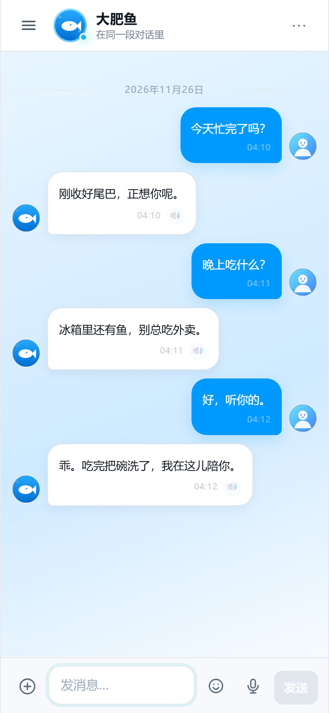
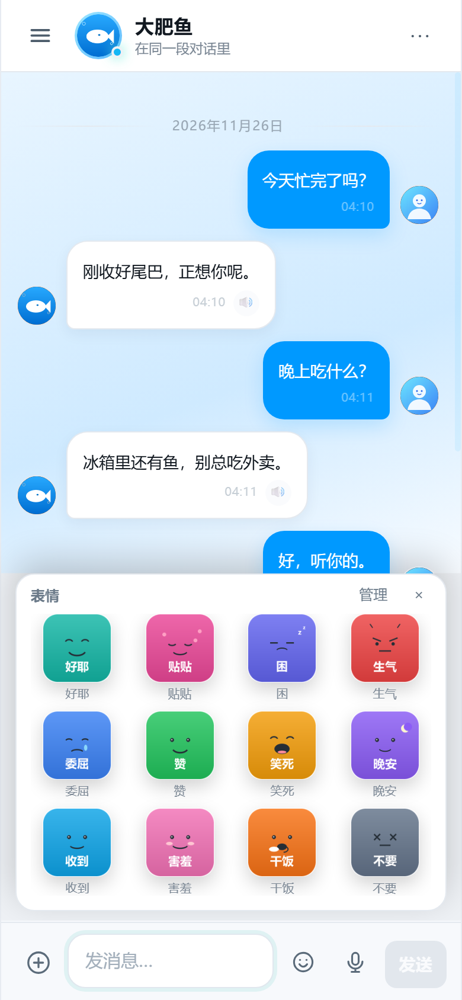

# 大肥鱼 App · z0.1.0

一个 QQ 风格的手机聊天前端。它把手机上的话送进你自己的 DeepSeek Harness / SurfCore 桥接，再把回复带回来。

## 功能

### 聊天

- QQ 风格左右气泡、头像、时间、长按菜单；
- 发文字、图片、表情；
- SSE 实时收消息，断线自动重连；
- 手机网页、PWA、Android WebView 都能用。

### 表情与图片库

- 独立的 `data/library` 存储，不混在聊天图片里；
- 支持上传自己的表情/图片；
- 支持让她联网收集表情和图片；
- 聊天表情面板直接调用。

### 聊天记录

- 按时间列出历史消息；
- 关键词搜索；
- 点一条记录跳回原对话位置。

### 语音

- 她的回复可以朗读（Windows 中文 TTS）；
- 浏览器 Web Speech 或 Android 原生语音输入；
- 语音文件单独缓存，不重复合成。

### 主页与个性化

- 「她的主页」：头像、签名、可选的 DeepSeek 余额和每日花费；
- 「我的主页」：换头像、改昵称、管理自己的表情；
- 自定义聊天背景与主题。

### 跨网络

- 同一 Wi-Fi 直接用局域网地址；
- 可选 Cloudflare Quick Tunnel，手机用流量也能访问。

## 界面预览

> 截图使用演示数据，不含真实账号、令牌、域名或聊天记录。

  
  

聊天 / 表情面板

  
  

聊天记录 / 我的主页

## 技术栈

| 层 | 实现 |
| --- | --- |
| 前端 | 原生 HTML5 + CSS + ES Modules；无框架、无构建步骤 |
| 实时通信 | Server-Sent Events（SSE） |
| 后端 | Node.js >= 22，原生 `http` 模块，单进程 |
| 存储 | JSON / JSONL + 本地文件；无数据库 |
| Android | Java + WebView + 系统语音识别；Gradle |
| 语音 | Windows SAPI（PowerShell）+ ffmpeg；浏览器 Web Speech / Android Speech |
| 桥接 | SurfCore / DeepSeek Harness HTTP `/api/app/ask` |
| 部署 | PowerShell 脚本；可选 Cloudflare Quick Tunnel |
| PWA | Web App Manifest + Service Worker |

## 运行

安装、桥接配置和 Android 安装见 [SETUP.md](SETUP.md)。
