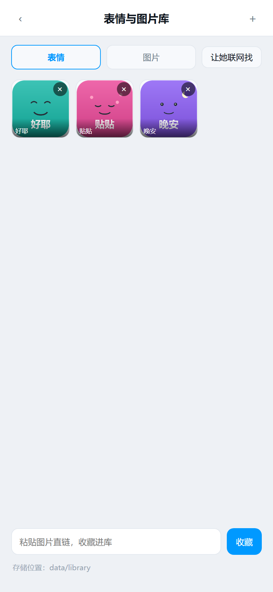
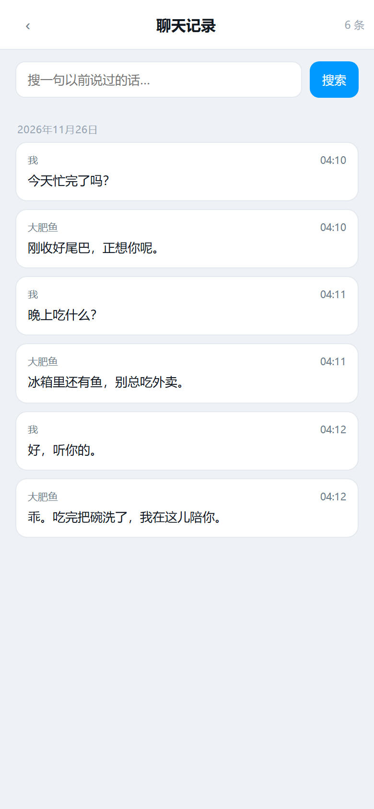
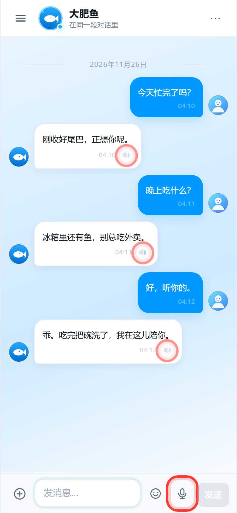
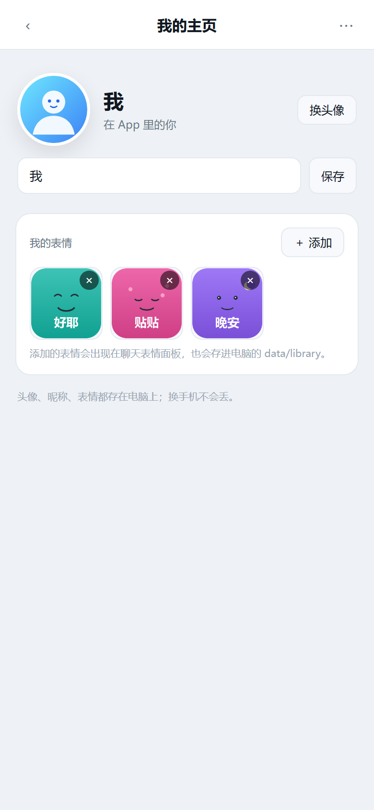
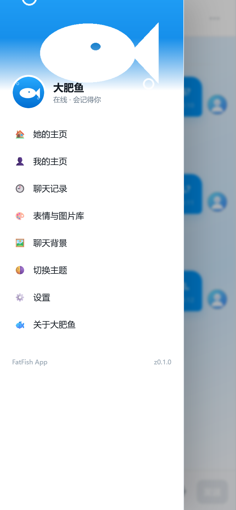
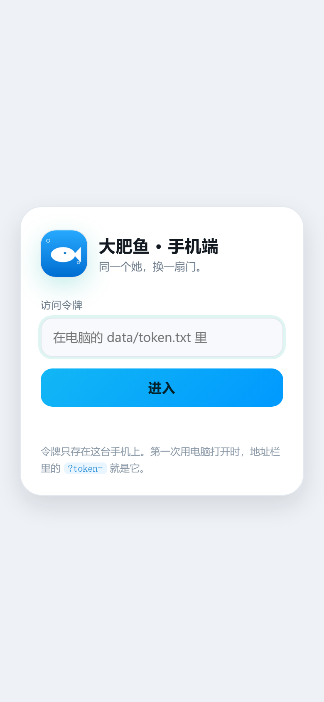

# 大肥鱼 App · z0.1.0

一个 QQ 风格的手机聊天前端。它把手机上的话送进你自己的 DeepSeek Harness / SurfCore 桥接，再把回复带回来。

> 截图均来自本地演示数据，不含真实账号、令牌、域名或聊天记录。

## 下载

- Release 页：本仓库 **Releases → z0.1.0**
- APK：`fat-fish-app-open-z0.1.0-debug.apk`
- 源码：本仓库 `main` / tag `z0.1.0`

## 快速开始

1. 电脑安装 **Node.js >= 22**（语音还需要 `ffmpeg`）；
2. 准备自己的桥接令牌，写入 `data/bridge-token.txt`，或设置 `BRIDGE_TOKEN` / `BRIDGE_URL`；
3. 运行 `start-app.ps1`，日志会打印访问地址和令牌；
4. 手机安装 APK，第一次打开填地址和访问令牌。

完整步骤见 [SETUP.md](SETUP.md)。

## 功能

### 聊天

- 左右气泡、头像、时间、长按菜单；
- 文字、图片、表情；
- SSE 实时收消息，断线自动重连；
- 手机网页、PWA、Android WebView 都能打开。

<p align="center">
  
</p>

### 表情与图片库

- 独立的 `data/library` 存储，不混在聊天图片里；
- 支持上传自己的表情和图片；
- 支持让她联网收集；
- 聊天表情面板直接读取。

<p align="center">
  
  
</p>

### 聊天记录

- 按时间列出历史消息；
- 关键词搜索；
- 点一条记录跳回原对话位置。

<p align="center">
  
</p>

### 语音

- 她的文字回复可以朗读；
- 输入框旁麦克风：浏览器 Web Speech 或 Android 系统语音识别；
- 语音单独缓存，不重复合成。

> 红圈标出的就是朗读按钮和语音输入按钮。

<p align="center">
  
</p>

### 主页与个性化

- 「她的主页」：头像、签名、可选的 DeepSeek 余额和每日花费；
- 「我的主页」：换头像、改昵称、管理自己的表情；
- 自定义聊天背景与主题。

<p align="center">
  
</p>

### 侧边栏

- 她的主页、我的主页、聊天记录、表情与图片库、背景、主题、设置、关于；
- 手机端的主要入口都在这里。

<p align="center">
  
</p>

### 连接与配对

- 手机第一次打开填访问令牌；
- 同一 Wi-Fi 直接用局域网地址；
- 不在同一网络时，用 Cloudflare Quick Tunnel 或自己的反向代理。

<p align="center">
  
</p>

## 技术栈

| 层 | 实现 |
| --- | --- |
| 前端 | 原生 HTML5 + CSS + ES Modules；无框架、无构建步骤 |
| 实时通信 | Server-Sent Events（SSE） |
| 后端 | Node.js >= 22，原生 `http` 模块，单进程 |
| 存储 | JSON / JSONL + 本地文件；无数据库 |
| Android | Java + WebView + 系统语音识别；Gradle |
| 语音 | Windows SAPI（PowerShell）+ ffmpeg；浏览器 Web Speech / Android Speech |
| 桥接 | SurfCore / DeepSeek Harness HTTP `/api/app/ask` |
| 部署 | PowerShell 脚本；可选 Cloudflare Quick Tunnel |
| PWA | Web App Manifest + Service Worker |

数据流：

```text
手机浏览器 / PWA / Android WebView
        │  Bearer token（App 访问令牌）
        ▼
Node.js 网关 server.mjs
        │  POST /api/app/ask + x-console-token
        ▼
SurfCore / DeepSeek Harness 桥接
        │
        ▼
人格 · 记忆 · 工具
```

项目结构：

```text
server.mjs              本地网关：静态页 + API + SSE + 历史
public/                 聊天页、通用头像、背景、内置表情
mobile/android/         Android WebView 壳（com.fatfish.app）
patches/                SurfCore /app/ask 参考补丁
scripts/                启动、测试、截图、TTS 脚本
data/                   运行时生成：令牌、账本、图片、语音（不提交）
```

## 常见问题

**手机打不开？**  
确认手机和电脑在同一 Wi-Fi，防火墙允许 8787；不在同一网络就用隧道或自己的反向代理。

**提示令牌无效？**  
用启动日志里的完整地址（含 `?token=`），或把 `data/token.txt` 里的令牌填进 App。

**桥接返回 404？**  
你的 SurfCore / DSH 还没有 `/api/app/ask`。看 [SETUP.md](SETUP.md) 应用补丁，或按接口契约适配。

**没有声音？**  
安装 `ffmpeg`，并确认 Windows 有中文语音组件；语音文件会缓存在 `data/voice`。

**APK 装不上？**  
允许“安装未知应用”；包名是 `com.fatfish.app`。

## 安全

- `data/token.txt` 等价于“以你的身份聊天”，不要发到公开群；
- `data/bridge-token.txt` / `BRIDGE_TOKEN` 也不要提交；
- `data/` 已在 `.gitignore`；
- 公网入口需要自己负责鉴权、TLS 和访问控制。

## License

MIT。见 [LICENSE](LICENSE)。
